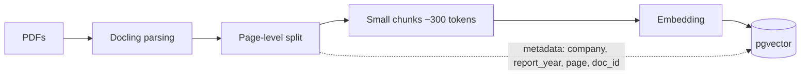
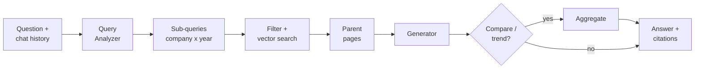

# NormRAG

A production-oriented Retrieval-Augmented Generation (RAG) system for enterprise documents, starting with PDF annual reports.

The first target use case is financial Q&A over automotive annual reports (Tesla, BMW, Ford): extracting metrics such as revenue and profit, comparing companies, and describing trends across years, with every answer grounded in cited pages.


## Design principles

- **Swappable components.** Parser, chunker, embedder, store, retriever, reranker and generator each sit behind an interface. The baseline uses the simplest implementation; later versions replace implementations without changing callers.
- **Config-driven.** Every feature is a flag in a YAML config, so different pipelines can be compared side by side.
- **Evaluation from day one.** A hand-labelled gold set (answers and source pages) is run after every change. Design decisions and their measured impact are recorded in `docs/decisions.md`.
- **Production-grade storage from the start.** Postgres + pgvector instead of local index files, so incremental updates, deletion and access control can be added later without a migration.
- **Minimal framework dependency.** Core logic (chunking, retrieval fusion, reranking, prompt assembly) is written directly on top of low-level libraries, so every step is transparent and debuggable.

## Architecture (V0)

### Ingestion (offline)



### Query (online)



| Step | Output |
|---|---|
| Query Analyzer | One LLM call with structured output: standalone question, companies, years, metric, intent |
| Generator | Structured output: analysis, answer, cited pages |

The Query Analyzer handles three concerns in one call:

- **Follow-up rewriting:** turns "what about 2022?" into a standalone question using the chat history.
- **Routing:** extracts companies and years for metadata filtering.
- **Decomposition:** splits comparison and trend questions into single company/year lookups.

Intents: `lookup`, `compare`, `trend`, `qualitative`.

**Note on report years:** a figure for year *Y* appears in the year-*Y* report and again as a comparative (possibly restated) in the year-*Y+1* report. Retrieval prefers `report_year = Y` and allows `Y+1` as a fallback; answers state which report the figure came from.

## Roadmap

| Version | Goal | Additions |
|---|---|---|
| **V0** | End-to-end baseline | Architecture above; FastAPI service and simple chat UI; Docker Compose; evaluation script over the gold question set |
| **V1** | Answer accuracy | LLM reranking blended with vector scores; intent-specific prompts; metric-compatibility checks; unit, currency and N/A rules; structured-output repair on schema failure |
| **V1.5** | Retrieval quality | BGE-M3 hybrid retrieval (dense + sparse) with ColBERT reranking, benchmarked against V1 |
| **V2** | Multiple formats and documents | Word (DOCX) support with section-level parents; content-hash deduplication; incremental ingestion and document versioning; async ingestion queue |
| **V3** | Production readiness | Authentication and document-level permissions; tracing (Langfuse); caching; cost tracking; evaluation regression in CI; cloud deployment |

## Evaluation

- **Gold set:** `data/v0/eval/questions.jsonl` holds questions with expected answers and source pages (see `data/v0/eval/README.md`).
- **Retrieval metrics:** recall@k and MRR against the labelled source pages.
- **Answer metrics:** exact or tolerance-based match for numeric answers; faithfulness and citation correctness for free-text answers.
- **Workflow:** every config is run against the full set, and results are logged per run for comparison.

## Project structure

```
normrag/
├── configs/            # baseline.yaml, v1_rerank.yaml, ...
├── src/normrag/
│   ├── ingestion/      # parsers/, chunkers/, pipeline.py
│   ├── store/          # vector store interface + pgvector implementation
│   ├── retrieval/      # retriever.py, rerankers/
│   ├── query/          # analyzer.py (rewriting, routing, decomposition)
│   ├── generation/     # prompts.py, schemas.py, generator.py
│   └── api/            # FastAPI app
├── data/
│   ├── v0/             # V0 corpus + eval/questions.jsonl (gold set)
│   └── v1/             # ERC2 datasets for V1 improvements
├── eval/               # run_eval.py
├── ui/                 # simple chat frontend (Streamlit / Gradio)
├── docs/
│   └── decisions.md    # design decisions and experiment results
└── docker-compose.yml
```

## Getting started

> Work in progress: setup instructions will be added with the V0 release.

## Acknowledgements

Several V1 techniques (LLM reranking, parent page retrieval, structured-output prompting with chain-of-thought, comparative query decomposition) are inspired by Ilya Rice's winning solution to the Enterprise RAG Challenge: [IlyaRice/RAG-Challenge-2](https://github.com/IlyaRice/RAG-Challenge-2).